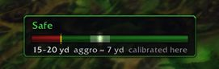

    

<h1 align="center">Safe Distance - Made for WoW Forever</h1>

I play a rogue, and I kept getting pulled one step before I could stealth. Sooo I made this.

Safe Distance tells you how close you are to your target's aggro range, so you know when to stop and stealth. Once you're stealthed, it switches to the mob's detection range instead.

You don't need to be a rogue though. It works the same for any class, if you just want to get past mobs without pulling them (like when you're picking herbs).

**It learns: every time a mob pulls you, it remembers the distance for next time.**

    

## What it does

- Shows a small box above your action bars with the distance, the aggro radius and a ruler: green is safe, yellow is the edge, red is too close.
- Puts a dot of the same color next to your target's nameplate, so you don't have to look down.
- Turns the ruler purple while you're stealthed and shows how close you can get before the mob sees you.
- Keeps what it learns per zone and per dungeon, because dungeon mobs don't always follow open-world numbers.
- Warns you about mobs that usually bring friends.

## Installation

👉 **CurseForge (Recommended):** install it from [CurseForge](https://www.curseforge.com/wow/addons/safe-distance), with the CurseForge app or by downloading the file there.

**Manually:**

1. Download `SafeDistance-x.y.z.zip` from the [latest release](../../releases/latest).
2. Extract it into `World of Warcraft\_forever_\Interface\AddOns\`.
3. Check that you ended up with `...\AddOns\SafeDistance\SafeDistance.toc`, then restart the game or type `/reload`.

If you used the green **Code -> Download ZIP** button instead, the folder will be called `SafeDistance-main`. Rename it to `SafeDistance`, or the game won't load it.

## How to use it

Target a mob and walk toward it. When the box turns yellow, stop (or stealth, if you can).

Settings are in `Options -> AddOns -> Safe Distance`, or just type `/sd`. `/sd help` lists every command. The ones you'll actually use:

- `/sd window`: see what it learned and delete anything that looks wrong
- `/sd offset -2`: if mobs keep letting you get closer than it says
- `/sd forget`: forget what it learned about your current target

## Good to know

- The game never tells addons the exact distance to a mob, only whether it's within a few fixed ranges. That's why you see something like 20-25 yd instead of one number.
- It only measures out of combat. Blizzard blocks this kind of check during fights.
- The first numbers are a guess (15 yards plus the level difference). They get better every time a mob pulls you.
- Mobs facing you spot stealth from farther away, and addons can't see which way a mob is facing.
- Linked pulls, patrols and scripted mobs can still surprise you.

## Found a bug?

Leave an issue:

1. what happened,
2. the full Lua error, if there was one,
3. what `/sd debug` prints right after.

_That last one lists which game functions refused to answer. Forever is still changing, so it helps a lot._

## Translations

English and Brazilian Portuguese for now. If you'd like to add your language, all the text is in `Locales.lua`.

## License

MIT. Range item IDs were checked against the public list in LibRangeCheck-3.0; no library code is included.
